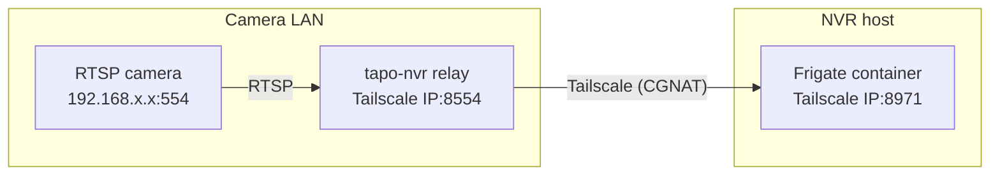

# tapo-nvr

[](https://github.com/Arudchayan/tapo-nvr/actions/workflows/ci.yml)
[](LICENSE)
[](pyproject.toml)

`tapo-nvr` connects a self-hosted [Frigate](https://frigate.video/) NVR to a
camera that lives on a different network. A small TCP relay runs next to the
camera and exposes **only the camera's RTSP port** on that host's
[Tailscale](https://tailscale.com/) address, so the camera's LAN is never
routable from the tailnet.

It was built for a TP-Link Tapo C220 but the relay is camera-agnostic: any
RTSP source works. It has been running 24/7 on Windows (relay) and Arch Linux
(Frigate in Docker); treat other combinations as beta and please report what
works.

It also includes `tapo-nvr sync`, which copies the camera's SD-card recordings
to a local or cloud-synced folder when there is no always-on NVR host, and
`tapo-nvr record`, which records the camera's RTSP stream on the laptop when
there is no SD card. The camera records by itself in sync mode; in record mode
the laptop is the recorder and only covers the time it is awake.

## Two supported setups

Both remain supported. Pick the one that matches the hardware you have.

| | Relay + Frigate (original) | Laptop + Drive (no always-on host) |
| --- | --- | --- |
| Always-on host | Yes: relay host and NVR host | No: the laptop records or copies while it is on |
| Storage | Frigate disk on the NVR host | Google Drive (or any synced folder) |
| Camera SD card | Optional | Required for `sync`; not used by `record` |
| Remote access | Tailscale | Google Drive |
| Commands | `relay`, `deploy`, `inspect`, `fetch-clip` | `sync` (SD-card clips) or `record` (RTSP on the laptop) |
| Coverage | 24/7 | Only while the laptop is awake; `sync` uses the camera SD as its buffer |

- **Relay + Frigate:** [Quick start](#quick-start) and
  [architecture](docs/architecture.md).
- **Laptop + Drive:** [SD-card sync](#back-up-sd-card-recordings-no-nvr-host) or
  [laptop recording](#record-on-the-laptop-no-sd-card).

## Why a relay instead of a subnet route?

Advertising a camera subnet route means every device on your tailnet can reach
every device on the camera LAN, usually including the camera's web UI and ONVIF
endpoints. A relay narrows the exposure to a single TCP port and lets Tailscale
ACLs be the access control layer. See
[docs/architecture.md](docs/architecture.md) for the full design.

## Architecture



- **Relay host** runs `tapo-nvr relay` plus Tailscale. It does not need router
  access, port forwarding, or IP forwarding.
- **NVR host** runs Tailscale and the Frigate Docker container. `tapo-nvr`
  manages the container over SSH from the relay host.

## Requirements

Relay host:

- Python 3.10 or newer (`python3` on Linux/macOS; on Debian/Ubuntu install
  `python3-venv` before creating a virtual environment)
- Tailscale, signed in to your tailnet
- Same LAN as the camera

NVR host:

- Docker Engine, with the SSH user allowed to run `docker` without `sudo`
  (typically `sudo usermod -aG docker <user>`, then log out and back in)
- Tailscale, signed in to the same tailnet
- Optional: `/dev/dri/renderD128` for VAAPI hardware acceleration

Both:

- The camera's *Camera Account* enabled (for Tapo cameras this is separate from
  the TP-Link cloud account; set it up in the Tapo app under the camera's
  settings).
- SSH access from the relay host to the NVR host. Key authentication is
  preferred; the NVR host key must be in `known_hosts` when
  `NVR_STRICT_HOST_KEY_CHECKING=true` (the default). See
  [docs/configuration.md](docs/configuration.md#nvr-host).

The management commands run from the relay host and reach the NVR host over
SSH.

For SD-card backup only, you do not need a second host, Docker, or Tailscale:
you need the camera, a microSD card, and a laptop on the same LAN. See
[Back up SD-card recordings](#back-up-sd-card-recordings-no-nvr-host). To record
the stream on the laptop instead, see
[Record on the laptop](#record-on-the-laptop-no-sd-card).

## Quick start

### 1. Install

```bash
git clone https://github.com/Arudchayan/tapo-nvr.git
cd tapo-nvr
python3 -m venv .venv

# Linux/macOS
source .venv/bin/activate

# Windows PowerShell
.venv\Scripts\Activate.ps1

pip install .
```

On Windows, if activation is blocked by the execution policy, run
`Set-ExecutionPolicy -Scope Process RemoteSigned` once per session.

You can also install it as an isolated CLI with [pipx](https://pipx.pypa.io/):

```bash
pipx install .
```

### 2. Configure

```bash
cp .env.example .env    # Windows: Copy-Item .env.example .env
```

Edit `.env` and set the camera address and credentials, a Tailscale-reachable
NVR host, and SSH details. Every setting is documented in
[docs/configuration.md](docs/configuration.md). The relay reads this file by
default; command-line flags override it.

### 3. Start the relay on the relay host

```bash
tapo-nvr relay            # reads CAMERA_HOST, RELAY_* from .env
tapo-nvr relay --target 192.168.1.50   # or pass everything explicitly
```

To run it automatically:

```powershell
# Windows: boot-time task + firewall rule (elevated PowerShell).
# Keep PYTHON_PATH pointed at the interpreter that has tapo_nvr installed.
deploy\windows\install-relay.ps1

# Windows: no-admin fallback
deploy\windows\install-relay-user-startup.ps1
```

```bash
# Linux: systemd (install the package into a venv the service can read)
sudo mkdir -p /opt/tapo-nvr
sudo python3 -m venv /opt/tapo-nvr/venv
sudo /opt/tapo-nvr/venv/bin/pip install .
sudo install -D -m 0644 deploy/systemd/tapo-nvr-relay.service /etc/systemd/system/tapo-nvr-relay.service
sudo install -D -m 0644 deploy/systemd/relay.env.example /etc/tapo-nvr/relay.env
sudoedit /etc/tapo-nvr/relay.env   # set CAMERA_HOST and PYTHON=/opt/tapo-nvr/venv/bin/python3
sudo systemctl daemon-reload
sudo systemctl enable --now tapo-nvr-relay
```

More detail, including uninstall steps, is in
[docs/service-installation.md](docs/service-installation.md).

### 4. Deploy Frigate on the NVR host

```bash
# Preview the generated configuration and container command first
tapo-nvr deploy --dry-run

# Write the configuration and (re)create the container over SSH
tapo-nvr deploy
```

### 5. Verify

```bash
tapo-nvr inspect          # JSON health checks, exits non-zero on failures
tapo-nvr fetch-clip       # downloads the newest recording
```

## Commands

| Command | Description |
| --- | --- |
| `tapo-nvr deploy` | Render the Frigate config, write it over SSH, and (re)create the container. Use `--dry-run` to preview and `--no-pull` to skip `docker pull`. |
| `tapo-nvr inspect` | JSON health checks for the camera, relay, Tailscale, container, image, and recent Frigate logs. `--scope local` or `--scope remote` narrows the checks. |
| `tapo-nvr fetch-clip` | Download the most recent MP4 from the NVR storage directory. |
| `tapo-nvr sync` | Download new SD-card recordings to a folder (for example a Google Drive folder). Requires the `sync` extra. |
| `tapo-nvr record` | Record the camera's RTSP stream continuously on this laptop, publish segments to a folder, and clean up locally. |
| `tapo-nvr relay` | Run the camera-only TCP relay. Reads `.env` by default; see `tapo-nvr relay --help`. |

`deploy`, `inspect`, `fetch-clip`, `sync`, and `record` accept `--env PATH`;
`relay` does too.

## Back up SD-card recordings (no NVR host)

Frigate needs a host that stays on. Without one, the camera can still record
24/7 to microSD, and a laptop can copy new clips to Google Drive whenever it is
awake. The camera is the recorder; the laptop is only a bridge.

### 1. Prepare the camera

Insert a high-endurance microSD card (up to 512 GB on the C220), open the Tapo
app, and enable **Storage & Recording → Local Recording**. Choose **Detection
Recording** for event clips or **Continuous Recording** for the full timeline.
The camera keeps recording while the laptop is off.

### 2. Install the optional dependency

```bash
pip install '.[sync]'
```

This installs [`pytapo`](https://github.com/JurajNyiri/pytapo), which talks to
the camera's local API. `sync` requires Python 3.11 or newer; the relay and
Frigate commands still support Python 3.10. You also need FFmpeg (`ffmpeg` and
`ffprobe`) on PATH.

### 3. Configure

Add your Tapo cloud account password to `.env` (this is the TP-Link account
password, not the Camera Account password), and point the output at your Google
Drive folder:

```dotenv
CAMERA_HOST=192.168.1.50
CAMERA_CLOUD_PASSWORD=your-tp-link-password
SYNC_OUTPUT_DIR=G:\My Drive\TapoNVR\sync
```

`--output` overrides `SYNC_OUTPUT_DIR`.

### 4. Run

```bash
tapo-nvr sync --dry-run --days 2   # list what would be copied
tapo-nvr sync --days 7             # first run: catch up the last week
tapo-nvr sync --days 2             # normal run
```

Clips are written as `SYNC_OUTPUT_DIR/YYYY-MM-DD/YYYYMMDD-HHMMSS-HHMMSS.mp4`.
Existing files are skipped, so the command is safe to run repeatedly.
`--date YYYY-MM-DD` and `--since YYYY-MM-DD` are available for backfills.

### 5. Schedule it

Anything that starts the command at logon works. On Windows:

```powershell
schtasks /Create /SC ONLOGON /TN "tapo-nvr sync" /RL LIMITED /TR "C:\path\to\.venv\Scripts\tapo-nvr.exe sync --env C:\path\to\.env --days 2"
```

Quote any path that contains spaces. On Linux, a cron entry:

```cron
@reboot cd /path/to/tapo-nvr && .venv/bin/tapo-nvr sync --days 2
```

The laptop does not need to stay on. The SD card is the buffer; the next run
catches up. A 512 GB card holds roughly 10–12 days of continuous 2K video, or
weeks to months of event clips, so schedule a run before the card wraps.

### Limits

- SD downloads use an unofficial Tapo API. A firmware update can break it; pin
  a working `pytapo` version and update deliberately.
- The laptop must be on the same LAN as the camera when the command runs. If
  the camera is remote, run the sync on a small always-on device there.
- `sync` only writes files. Google Drive for Desktop (or another folder-sync
  client) performs the upload; wait for it to finish before shutting the laptop.
- A full day of continuous 2K video takes a few hours to copy; event clips are
  much faster. Google Drive's free 15 GB fills quickly with continuous video.
- Tapo Care is the supported zero-maintenance cloud option, but it stores event
  clips only, not 24/7 continuous video.

## Record on the laptop (no SD card)

If you don't have an SD card and accept that recording only happens while this
laptop is on, `tapo-nvr record` can record the camera's RTSP stream itself. It
writes clock-aligned segments to a local staging folder, copies each finished
segment into a publish folder (your Google Drive mount), and deletes the local
copy after a grace period. Google Drive for Desktop performs the upload.

```text
Camera RTSP -> ffmpeg on laptop -> local staging -> Google Drive folder
                                      |
                                      +-> deleted after RECORD_KEEP_HOURS
```

The camera has no buffer in this mode. Sleep, shutdown, or a Wi-Fi drop is a
permanent gap; the previous SD-card mode is what covers those gaps.

### 1. Configure

RTSP needs `CAMERA_USERNAME` and `CAMERA_PASSWORD`. These are normally the
Camera Account from the Tapo app; some firmware also accepts the Tapo cloud
account. `tapo-nvr record --check` tells you if authentication works.

```dotenv
CAMERA_HOST=192.168.1.50
CAMERA_USERNAME=the-camera-account
CAMERA_PASSWORD=its-password

RECORD_OUTPUT_DIR=G:\My Drive\TapoNVR\record
RECORD_STAGING_DIR=E:\tapo-staging
RECORD_SEGMENT_SECONDS=1800
RECORD_KEEP_HOURS=24
```

`RECORD_OUTPUT_DIR` empty defaults to `recordings/record`; it is deliberately
separate from `SYNC_OUTPUT_DIR` so recorder retention cannot delete sync clips.
`RECORD_STAGING_DIR` empty uses `~/.tapo-nvr/recording`. Keep staging on a local
disk, not the Drive mount.

Create the output sentinel once, after the Drive folder is mounted:

```powershell
New-Item -ItemType File "G:\My Drive\TapoNVR\record\.tapo-nvr-output" -Force
```

The recorder refuses to publish if that file is missing. This stops it from
recreating a vanished Drive mount as a local folder and deleting the only copy.

### 2. Test and run

```bash
tapo-nvr record --check   # probe RTSP and the output folder
tapo-nvr record           # record until Ctrl+C
```

Segments are written as
`RECORD_OUTPUT_DIR/YYYY-MM-DD/YYYYMMDD_HHMMSS.mp4`. A segment is published after
it has been closed for a couple of minutes, and the local copy is removed only
after the published file exists, has the same size, and is older than
`RECORD_KEEP_HOURS`.

### 3. Keep the laptop awake

Plug it in and set:

- Sleep when plugged in: **Never**.
- Closing the lid: **Do nothing**.
- Start `tapo-nvr record` at logon. On Windows,
  `deploy\windows\start-record.ps1` is a small supervisor that restarts the
  recorder after a failure and exits on a clean Ctrl+C. Point a Startup
  shortcut at it:

  ```powershell
  powershell.exe -NoProfile -WindowStyle Hidden -ExecutionPolicy Bypass `
    -File "C:\path\to\tapo-nvr\deploy\windows\start-record.ps1"
  ```

The recorder restarts ffmpeg automatically if the stream drops or if the active
segment stops growing for `RECORD_STALL_SECONDS`. It writes a rotating log and a
JSON status heartbeat, stops with exit code 3 when staging free space falls
below `RECORD_MIN_FREE_GB`, and exits non-zero if its recording thread dies.
If the laptop sleeps, recording stops until it wakes.

### Storage

A 2K stream is roughly 28–40 GB per day; a 30-minute segment is under 1 GB. Set
`CAMERA_RECORD_STREAM=stream2` for the lower-resolution substream (about
1 GB/day, lower detail). Keep `RECORD_KEEP_HOURS` long enough for Google Drive
to finish uploading, and make sure the staging disk has at least a day of
headroom.

`RECORD_OUTPUT_KEEP_DAYS=7` deletes published files older than seven days from
the Drive folder, keeping roughly 200 GB of 2K video. Leave it at `0` to keep
everything in Drive and manage retention yourself.

## Security model

- The relay binds to a local address and, by default, accepts clients only from
  `100.64.0.0/10` (the Tailscale CGNAT range) and only forwards a single TCP
  port to the camera.
- Camera credentials are transferred over SSH and written to a mode `0600`
  environment file on the NVR host. They never appear in the Frigate YAML,
  which references them through `{FRIGATE_*}` placeholders.
- SSH host keys are verified by default (`NVR_STRICT_HOST_KEY_CHECKING=true`).
- No router ports are opened and no camera subnet route is advertised.
- `tapo-nvr inspect` and `tapo-nvr deploy` redact credentials from any output
  they print.

See [SECURITY.md](SECURITY.md) for the threat model, hardening
recommendations, and an example Tailscale ACL.

## Documentation

- [Configuration reference](docs/configuration.md)
- [Architecture and threat model](docs/architecture.md)
- [Installing the relay as a service](docs/service-installation.md)
- [Troubleshooting](docs/troubleshooting.md)

## Contributing

Contributions are welcome. See [CONTRIBUTING.md](CONTRIBUTING.md) and
[CODE_OF_CONDUCT.md](CODE_OF_CONDUCT.md).

## License

[MIT](LICENSE)
